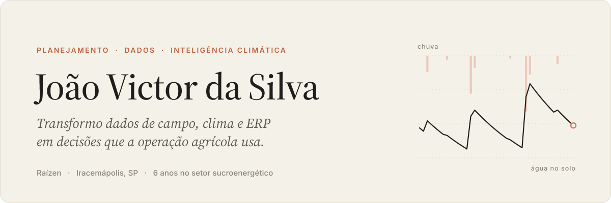
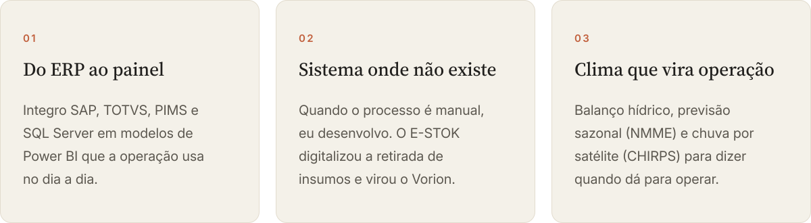

 

Comecei no controle de insumos, frota e ordens de serviço de uma usina. Hoje trabalho com planejamento e inteligência climática na **Raízen**. Nesses 6 anos, aprendi que quase nunca falta dado no agro. O que falta é juntar o que está espalhado entre SAP, TOTVS, PIMS e planilhas, e entregar isso a tempo de mudar a decisão. É nesse ponto que eu trabalho.

 

### Projetos

| Projeto | O que é |
|---|---|
| **[PARSEC](https://github.com/joaovictorss04/PARSEC)** | Plataforma gratuita de inteligência hídrica: balanço hídrico sequencial, chuva e previsão para indicar a disponibilidade operacional de cada fazenda. *Em desenvolvimento.* |
| **Vorion** | Plataforma modular de gestão para operações agrícolas: estoque de insumos, ordens de serviço e suprimentos. React, Node.js e PostgreSQL. *Módulo de estoque em uso.* |

### Ferramentas

| Área | Ferramentas |
|---|---|
| **BI e análise** | Power BI · DAX · Power Query (M) · Excel avançado · modelagem Star Schema |
| **Dados** | SQL Server · PostgreSQL · SQLite · SSIS · Python (pandas) · PySpark |
| **Cloud** | Azure Data Lake · Azure Synapse · SAP Datasphere |
| **ERP e agro** | SAP S/4HANA (MM/PM) · TOTVS · PIMS |
| **Clima e geodados** | Thornthwaite-Mather · CHIRPS · NOAA/NMME · NASA POWER · Google Earth Engine |
| **Desenvolvimento** | Python · Node.js · React · Java · Git |

 

  <a href="https://www.linkedin.com/in/joaovictorslv">LinkedIn</a> 

